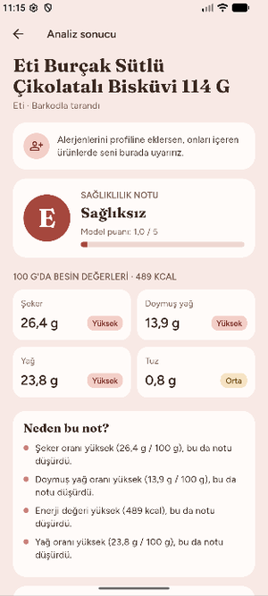
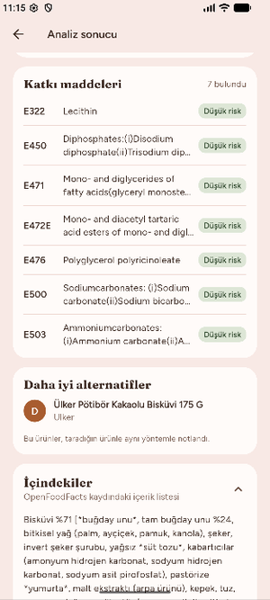
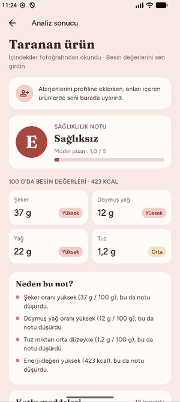
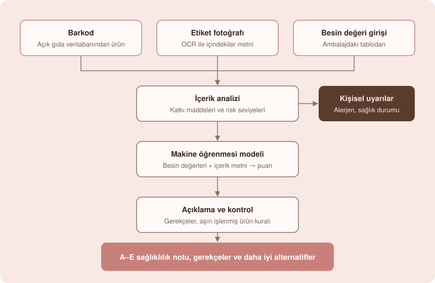

  

<h1 align="center">Akıllı Besin Asistanı</h1>

  Paketli gıdaların etiketini okuyup sağlıklılık notu veren, notun nedenini açıklayan 
  ve kullanıcının alerjenlerine göre kişisel uyarılar üreten Android uygulaması.

  
  
  
  

> Bu proje, **TÜBİTAK 2209-A Üniversite Öğrencileri Araştırma Projeleri Destekleme Programı** kapsamında desteklenen bir lisans araştırma projesi olarak başladı ve bir mobil uygulamaya dönüştürülüyor.

---

## Neden?

Market raflarındaki ürünlerin içindekiler listeleri uzun, katkı maddeleri E-kodlarıyla yazılı ve besin değeri tabloları her ambalajda farklı yerde. Akıllı Besin Asistanı bu bilgiyi saniyeler içinde okuyup tek bir soruya cevap veriyor: **Bu ürün benim için ne kadar uygun, ve neden?**

## Ekran görüntüleri

  
  &nbsp;
  
  &nbsp;
  

Barkod sonucu · Katkı maddeleri ve alternatifler · Etiket fotoğrafı ile tarama

## Özellikler

- **Barkodla tarama:** Ürün bilgileri açık bir gıda veritabanından otomatik olarak alınır.
- **Etiket fotoğrafıyla tarama:** Barkodu bulunamayan ürünlerde içindekiler listesi OCR ile okunur. Besin değerleri ambalajdaki tablodan girilerek not alınabilir; girilen değerler tutarlılık kontrollerinden geçer.
- **A–E sağlıklılık notu:** Bir makine öğrenmesi modeli; besin değerlerini, içerik metnini ve katkı maddelerinin risk seviyelerini birlikte değerlendirir.
- **Açıklanabilir sonuç:** "Neden bu not?" bölümü, notu en çok etkileyen etkenleri sade cümlelerle gösterir. Aşırı işlenmiş ürünler için uygulanan uzman kuralı devreye girdiğinde bu da açıkça belirtilir.
- **Katkı maddesi analizi:** E-kodları hem kod hem ad olarak tanınır ve risk seviyeleriyle listelenir.
- **Kişisel uyarılar:** Alerjenler etikette farklı adlarla geçse de yakalanır ("içerebilir" uyarıları ayrıca gösterilir). Diyabet, çölyak, yüksek tansiyon ve kolesterol gibi durumlar için ilgili değerler işaretlenir.
- **Daha iyi alternatifler:** Aynı kategoride, Türkiye'de satılan, profiline uygun ve aynı yöntemle daha iyi not alan ürünler önerilir.
- **Tarama geçmişi ve hesap yönetimi:** Taramalar kullanıcı hesabına kaydedilir; hesap ve tüm veriler uygulama içinden silinebilir.

## Nasıl çalışır?

  

Üç giriş yolu da aynı analizden geçer. Temel besin değerleri yeterli değilse sistem tahmine dayalı bir not üretmez; yalnızca içerik ve katkı maddesi analizini gösterir. Yanlış bir not göstermektense not vermemek tercih edilir.

## Teknolojiler

| Katman | Teknoloji |
| --- | --- |
| Mobil uygulama | Flutter (Android) |
| Sunucu | Python, FastAPI |
| Veritabanı | MySQL |
| Makine öğrenmesi | XGBoost, TF-IDF, SHAP |
| Metin tanıma | Tesseract / EasyOCR |
| Ürün verisi | Open Food Facts |

## Gizlilik yaklaşımı

- Sağlık durumu bilgileri yalnızca kullanıcının açık rızasıyla kaydedilir ve sadece kişisel uyarılar için kullanılır.
- Kullanıcı hesabını ve tüm verilerini uygulama içinden kalıcı olarak silebilir.
- Uygulama bilgilendirme amaçlıdır ve tıbbi tavsiye yerine geçmez.

## Durum ve yol haritası

- [x] Araştırma prototipi ve model geliştirme
- [x] Sunucu, kullanıcı sistemi ve tarama geçmişi
- [x] Flutter uygulaması: barkod, fotoğraf, profil, sonuç ekranı
- [x] Kişisel uyarılar ve daha iyi alternatif önerileri
- [ ] Gerçek cihazlarda kapsamlı test
- [ ] Google Play yayını

## Kaynak kod

Proje aktif olarak geliştirilmektedir; kaynak kod şu an paylaşılmamaktadır. Bu depo, projenin tanıtımı içindir.

## Teşekkür

- Proje, TÜBİTAK 2209-A programı tarafından desteklenmiştir.
- Ürün verileri [Open Food Facts](https://world.openfoodfacts.org) açık veritabanından alınmaktadır (ODbL lisansı).

---

© 2026 · Tüm hakları saklıdır.

